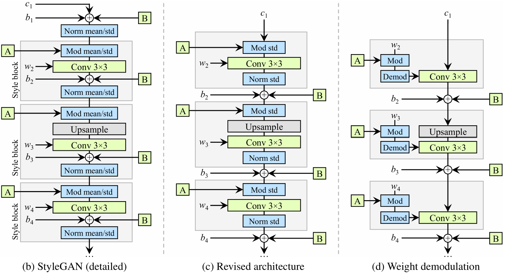

# Synthetic Brain MRI Generation with StyleGAN2

## Project Overview

This project investigates the generation of synthetic brain MRI images using StyleGAN2 on the ADNI dataset.

The egineering dilemma is the fidelity-memorization-privacy trade-off in synthetic medical image generation. A useful generative model should produce diverse synthetic MRI slices while avoiding memorisation of individual training samples.

The proposed model is evaluated against a simpler baseline generative model using Structural Similarity Index (SSIM) for image fidelity, distributional metrics such as FID or feature-space distance, t-SNE/UMAP analysis of real and synthetic samples, qualitative failure-case inspection, and nearest-neighbour analysis for potential training-data memorisation.

## 1. Engineering Problem and Motivation
Medical-imaging and machine-learning researchers need varied image data to develop and evaluate 
computational methods, but access to patient images is constrained by data availability and privacy 
requirements. Synthetic brain MRI generation offers a potential source of supplementary research images. 
This project investigates whether a generative model can capture structural variation in the available data and produce additional samples that warrant further investigation for research use.

The engineering challenge extends beyond generating visually convincing images. 
The model may reproduce the overall brain outline while losing structural details, 
generate similar outputs, or produce images that closely resemble individual training samples. 
Furthermore, generative models can also expose information about their training data, 
as demonstrated by the membership-inference attacks in LOGAN [1]. 
These concerns motivate a joint assessment of fidelity, diversity, memorisation risk and computational cost. 
The central question is whether StyleGAN2 [2][3] improves image quality and diversity sufficiently over DCGAN [4] 
to justify its additional computational demands, while avoiding obvious memorization of training images.


## 2. Feasibility Review

### 1. User Need, Scope and Acceptance Criteria

The intended users of this prototype are medical-imaging and machine-learning researchers 
who require additional brain MRI data for model development but face limited clinical scan 
availability and patient privacy.

This project is to investigate whether StyleGAN2 can produce genuinely novel, diverse, and anatomically
coherent scans without simply memorising training patients. Structural similarity is assessed 
using SSIM [5], while distributional similarity is assessed using Fréchet Inception Distance (FID) [6]

A DCGAN is used as a simpler baseline to assess whether StyleGAN2's additional architectural 
and computational complexity provides a meaningful engineering advantage.

The prototype will be evaluated against the following criteria:

1. Reference-paired SSIM will be reported using the predefined nearest-neighbour matching protocol, including the proportion of generated images with SSIM > 0.6. This threshold is treated as a project evaluation target rather than evidence of clinical validity.
2. StyleGAN2 should provide measurable improvement over the DCGAN baseline in structural fidelity and distribution fidelity.
3. Generated samples and real-versus-synthetic embedding analysis should not show obvious mode collapse or severely restricted diversity.
4. Nearest-neighbour analysis should not reveal obvious near-duplicate training images that would indicate potential memorisation.
5. Training must remain feasible on the NVIDIA A100 40 GB GPU, with peak VRAM usage and training/generation runtime explicitly profiled.

### 2. Model Choice and Course Concepts

The project uses the ADNI brain MRI dataset and a StyleGAN2 generator as the proposed Hard-Difficulty model. A DCGAN trained using the same preprocessing workflow is used as the baseline.

StyleGAN2 was selected because its mapping network, intermediate latent space, learned affine style transformations, style-modulated convolutions and weight demodulation provide substantially greater control over image synthesis than a standard DCGAN. These components directly relate to generate high-quality and diverse new MRI samples, thus potentially reducing the need for directly sharing real patient scans.

Compared with the original StyleGAN, StyleGAN2 improves the synthesis architecture to reduce characteristic image artefacts and improve image fidelity. This is particularly relevant to brain MRI generation, where fine anatomical structures and tissue boundaries must be preserved to produce clinically plausible synthetic images.

### 3. Preliminary Feasibility Evidence

An initial audit of the ADNI dataset will document the number of patients, usable slices, original image dimensions, preprocessing resolution and normalisation strategy. The validation set is separated from the training data by patient, while the supplied test partition is retained. The DCGAN baseline is trained with the preprocessed ADNI data to establish initial quality and resource benchmarks. And StyleGAN2 will be trained using the same preprocessed datasets.

An initial StyleGAN2 smoke test has successfully run on an NVIDIA A100 40GB GPU in the cluster rangpur. At batch size 8, the first training epoch processed approximately 17.48 kimg and required 1191 s. Peak allocated GPU memory was 36.24 GiB and peak reserved memory was 36.46 GiB. The higher first-epoch memory peak is consistent with additional startup and convolution algorithm-selection overhead. Once the convolution algorithms and memory buffers had been initialised, subsequent epochs stabilised at below approximately 7 GiB of reserved VRAM.

These results indicate that the current model configuration fits within the available 40 GB GPU memory, although training cost is significant.

### 4. Risks, Compute Budget and Fallback

The main risks include unstable adversarial training, restricted sample diversity, discriminator overfitting and potential memorisation. Previous work identifies discriminator overfitting as a challenge when training GANs with limited data [7], while membership-inference studies demonstrate that generative models may expose information about their training data [1].

Also, the current measured training cost is approximately 20 minutes per epoch on rangpur with a-100. Longer training runs will therefore be guided by intermediate sample quality and training stability. Early stopping can be used to reduce the overfitting.

The DCGAN baseline under will be trained on the preprocessed datasets and compared initial sample quality, SSIM/FID, runtime and GPU memory against StyleGAN2.

Training will initially use established StyleGAN2 hyperparameter settings. If overfitting, unstable convergence, 
or insufficient improvement over the DCGAN baseline is observed, targeted adjustments to 
learning rates and regularisation settings will be considered based on the identified issues. 
Adaptive discriminator augmentation [8] remains a possible extension for future investigation.

If these adjustments are insufficient, a reduced StyleGAN2 configuration, such as lower image resolution or fewer feature channels, will be considered to reduce computational requirements while retaining the core architecture.

If the model still fails to converge or produces anatomically implausible images, the best available checkpoint will be retained and evaluated against the DCGAN baseline. Representative failure cases will be documented and analysed to identify possible causes and limitations. The final report will transparently discuss unsuccessful experiments and whether StyleGAN2's additional complexity is justified by its observed performance.

## 3. Dataset

### 3.1 Data Source and Composition

The project uses the course-provided ADNI brain MRI subset, supplied as two-dimensional JPEG slices 
in Alzheimer's disease (AD) and normal control (NC) folders. Both groups are pooled for 
unconditional generation; diagnostic labels are retained for dataset statistics but are not 
provided to the models. Scan identifiers in the filenames are linked to patient identifiers through
the supplied metadata.

### 3.2 Dataset Partitions

The supplied test partition is retained. The original training partition is divided by patient, 
assigning 20% of its patients to validation using a fixed random seed of 42. 
All slices associated with a selected patient remain in the same training or validation partition. 
Both models use the same saved split manifest.

| Split | Patients | Scan IDs | AD slices | NC slices | Total slices |
|---|---:|---:|---:|---:|---:|
| Training | 452 | 874 | 8,820 | 8,660 | 17,480 |
| Validation | 113 | 202 | 1,580 | 2,460 | 4,040 |
| Test | 331 | 450 | 4,460 | 4,540 | 9,000 |

Although the training set contains similar numbers of AD and NC slices, these originate from 
substantially fewer AD patients, indicating unequal contributions per patient. 
Training and validation contain no shared patients. However, the supplied test partition shares 
169 patients with training and 47 with validation. Patient counts are therefore unique within each 
partition, not across the entire table. Test results should not be interpreted as performance on 
a fully patient-independent cohort.

### 3.3 Preprocessing

Each JPEG is converted to single-channel grayscale and padded with black pixels along its shorter 
dimension to produce a 256 × 256 image. No resizing or cropping is applied, preserving the original 
pixel grid. Pixel intensities are converted to float32 and normalised from [0, 255] to [-1, 1], 
yielding an input tensor of shape [1, 256, 256]. The same deterministic preprocessing is used for 
both models and all partitions, without random data augmentation.

## 4. Method

### 4.1 Adversarial Framework and DCGAN Baseline

The generative adversarial framework consists of a generator G, which maps random latent variables 
to synthetic images, and a discriminator D, which learns to distinguish generated images from real 
samples. Their competing objectives encourage the generator to approximate the training image distribution.

DCGAN provides the baseline. Its generator transforms a latent vector through transposed-convolution 
blocks with batch normalisation and ReLU activations, followed by a Tanh output layer. 
Its discriminator uses strided convolutions, batch normalisation in intermediate blocks and 
LeakyReLU activations, producing a single logit. Training uses binary cross-entropy with logits.

StyleGAN2 retains the adversarial framework but introduces layer-wise style control, a different 
synthesis architecture and additional regularisation. The DCGAN baseline and StyleGAN2 use 
mathematically equivalent adversarial losses, expressed as BCE and non-saturating logistic losses, 
respectively. The methodological differences therefore concern the architecture and training 
regularisation rather than the naming of the adversarial loss.

### 4.2 Mapping Network and Style-Based Generation

Unlike DCGAN, which introduces the latent vector at the generator input, the style-based 
architecture first transforms a sampled latent vector z into an intermediate representation w 
through a mapping network f. Each synthesis layer then applies its own learned affine transformation 
to obtain style coefficients:

$$
z \sim \mathcal{N}(0,I), \qquad
w=f(z), \qquad
s_{\ell}=A_{\ell}(w).
$$

<p align="center">

<br>
<em>
Figure 1. Mapping and synthesis networks of the original StyleGAN. From Karras et al. [3], Fig. 1(b). 
<strong>A</strong> denotes a learned affine transformation, while <strong>B</strong> applies 
learned scaling to the noise input. AdaIN belongs to the original StyleGAN design and is replaced 
by weight modulation and demodulation in the StyleGAN2 implementation.
</em>
</p>

As shown in Figure 1, the mapping network converts z into w, which controls synthesis through 
layer-specific styles. The synthesis network starts from a learned spatial constant rather than 
directly from z. Independent noise inputs provide stochastic variation at different resolutions. 
Although the constant is shared between samples, the styles and noise allow different images to be generated.

This separation provides a mechanism for modelling variation at different spatial scales, 
motivating its use for both broad brain structure and finer image appearance. However, it does not 
establish a correspondence between individual latent dimensions and anatomical or diagnostic 
attributes. StyleGAN2 retains this mapping-and-synthesis framework but changes how styles control 
the convolutions, as described below.

### 4.3 Weight Modulation and Demodulation

In the original architecture shown in Figure 1, adaptive instance normalisation (AdaIN) normalises 
feature maps before applying style-dependent scaling and offsets. Karras et al. [4] link this 
operation to characteristic droplet-like artefacts, as it can remove information carried by 
relative feature magnitudes. StyleGAN2 replaces explicit feature-map instance normalisation with 
weight modulation and demodulation.

<p align="center">

<br>
<em>
Figure 2. Redesign of the StyleGAN synthesis layer. From Karras et al. [4], Fig. 2. 
Panel (b) expands the original AdaIN operation, panel (c) reorganises the style block, 
and panel (d) replaces explicit feature normalisation with weight modulation and demodulation. 
Panel (a) provides the original synthesis-layer overview, whose mapping and noise pathways are shown more fully in Figure 1.
</em>
</p>

Figure 2(b) separates AdaIN into normalisation and modulation. Following the intermediate revision 
in Figure 2(c), the design in Figure 2(d) incorporates style-dependent scaling and its compensation 
into the convolution weights. This final mechanism is adopted in the present implementation.

Figure 2 uses $w_2$, $w_3$, and $w_4$ for convolution weights, distinct from the latent vector $w$. 
Here, $K$ denotes the learned base weights, $\widetilde{K}$ the style-modulated weights, 
and $\widehat{K}$ the final demodulated weights:

$$
\widetilde{K}_{o,i,u,v}=s_iK_{o,i,u,v}

\qquad

\widehat{K}_{o,i,u,v}
=
\frac{\widetilde{K}_{o,i,u,v}}
{\sqrt{\sum_{i,u,v}\widetilde{K}_{o,i,u,v}^{\,2}+\epsilon}}.
$$

Here, $s_i$ is the sample-specific style coefficient for input channel $i$, $o$ indexes output 
channels, and $(u,v)$ indexes kernel positions. Modulation adjusts each input channel's 
contribution, while demodulation compensates for the resulting output scale under the unit-variance 
input assumption [4]. This operates on weights rather than measured feature-map statistics.

For MRI synthesis, reducing architecture-induced artefacts is relevant because artificial patterns 
can obscure or resemble structural detail. This provides a theoretical motivation for the mechanism, 
rather than a guarantee that generated anatomy is correct.

### 4.4 Multi-Scale Synthesis and Discriminator

The generator synthesises features from a learned 4 × 4 constant through successive resolution blocks. 
At each resolution, a style-modulated 1 × 1 convolution projects features into a single-channel 
image contribution. These contributions are combined through output skip connections:

$$
I_r=\operatorname{Upsample}(I_{r/2})
+\operatorname{ToImage}_r(x_r),
$$

where $x_r$ denotes the features at resolution $r$. The ToImage layers use modulation without 
demodulation. Filtered upsampling is used between resolutions. All resolution blocks are trained 
together from the start, rather than being added gradually during training.

Noise is added after the styled convolutions with a learned strength, followed by bias and activation. 
It provides a separate source of local stochastic variation, reducing the need to encode every 
detail in the latent vector. In this project, noise injection is a synthesis mechanism, not a 
calibrated model of physical MRI acquisition noise.

The discriminator follows the residual design adopted in StyleGAN2. Each downsampling block combines 
a convolutional main branch with a skip branch, with the sum scaled by $1/sqrt(2)$. A grouped 
minibatch-standard-deviation feature is added before the output layers to capture variation among 
samples. This allows the discriminator to use batch-level diversity cues, although it does not 
guarantee prevention of mode collapse. The discriminator outputs a single logit per image at the end 
of the network.

### 4.5 Training Objectives and Regularisation

StyleGAN2 is trained using non-saturating logistic objectives. With D denoting discriminator logits 
and $\operatorname{softplus}(t) = \log(1 + \exp(t))$, the adversarial losses are:

$$
L_D^{adv}
=
\mathbb{E}_{x}
\left[\operatorname{softplus}(-D(x))\right]
+
\mathbb{E}_{z}
\left[\operatorname{softplus}(D(G(z)))\right]
$$

$$
L_G^{adv}
=
\mathbb{E}_{z}
\left[\operatorname{softplus}(-D(G(z)))\right].
$$

Generator noise is implicit in this notation. R1 regularisation penalises the discriminator's input 
gradients at real images:

$$
R_1=
\frac{\gamma}{2}
\mathbb{E}_{x}
\left[\left\|\nabla_x D(x)\right\|_2^2\right].
$$

This constrains local discriminator sensitivity around real samples and supports stable optimisation. 
It does not impose a formal privacy guarantee.

Path length regularisation encourages a consistently scaled response to changes in the style vectors:

$$
\ell=
\sqrt{
\frac{1}{L}
\sum_{j=1}^{L}
\left\|
\nabla_{w_j}
\langle g(\mathbf{w}),y\rangle
\right\|_2^2
}

\qquad

R_{PL}=\lambda_{PL}\mathbb{E}\left[(\ell-a)^2\right].
$$

Here, $L$ is the number of style inputs, $y$ is resolution-normalised Gaussian noise, and $a$ is a moving average of the measured path lengths.

R1 and path length penalties use lazy regularisation, with interval scaling and corresponding 
optimiser adjustments. Style mixing discourages dependence between neighbouring styles, while 
generator EMA weights are used for sampling and final evaluation. The model is trained without ADA 
and evaluated against DCGAN as a complete system, without component-wise ablations.


## 5. Implementation

### 5.1 Project Structure

```text
recognition/
└── StyleGAN2_s4909628/
    ├── modules.py
    ├── dataset.py
    ├── train.py
    ├── predict.py
    └── README.md
```


## 6. Experimental Setup


## 7. Quantitative Evaluation


## 8. Baseline vs Proposed Model

### 8.1 Quantitative Comparison

| Metric | DCGAN Baseline | StyleGAN2 |
|---|---:|---:|
| SSIM | TODO | TODO |
| FID | TODO | TODO |
| Diversity Metric | TODO | TODO |
| Parameter Count | TODO | TODO |
| Peak GPU VRAM | TODO | TODO |
| Training Time | TODO | TODO |
| Generation Time per Image | TODO | TODO |


## 9. Real vs Synthetic Distribution Analysis


## 10. Memorisation and Privacy Audit

### 10.1 Motivation
A synthetic image that closely reproduces a training patient scan may indicate memorisation rather than genuine generation. Therefore, visual realism alone is not sufficient.

### 10.2 Nearest-Neighbour Analysis
For each selected synthetic image:
1. extract its representation;
2. compare it against training images;
3. identify its nearest training neighbour;
4. report similarity / distance;
5. visually inspect the image pair.

### 10.3 Example Nearest-Neighbour Results

| Synthetic Image | Nearest Training Image | Distance / Similarity | Observation |
|---|---|---:|---|
| Sample 1 | TODO | TODO | TODO |
| Sample 2 | TODO | TODO | TODO |
| Sample 3 | TODO | TODO | TODO |

#### Sample 1

**Synthetic Image**


**Nearest Training Image**


**Distance / Similarity:**  
TODO

**Observation:**  
TODO


## 11. Latent Space Investigation


## 12. Qualitative Results


## 13. Failure Case Autopsy

Analyse at least 3–5 representative failure cases from the generated results.

### Failure Case 1 — TODO

**Observed Failure:**  
stylegan2 000131

**Possible Trigger:**  
TODO

**Likely Model Behaviour:**  
TODO

**Engineering Significance:**  
TODO

---

### Failure Case 2 — TODO

**Observed Failure:**  
stylegan2 000158

**Possible Trigger:**  
TODO

**Likely Model Behaviour:**  
TODO

**Engineering Significance:**  
TODO

---

### Failure Case 3 — TODO

**Observed Failure:**  
stylegan2 000400
stylegan2 001444
stylegan2 001800
stylegan2 003184

**Possible Trigger:**  
TODO

**Likely Model Behaviour:**  
TODO

**Engineering Significance:**  
TODO


## 14. Fidelity–Memorization–Privacy Trade-off
Summarise the central engineering dilemma.


## 15. Engineering Recommendation


## 16. Limitations


## 17. Conclusion


## 18. Usage


## 19. Artificial Intelligence Usage Disclosure
ChatGPT was used during the development of this project.
Used to assist in learning, building network architectures and evaluation metrics, and debugging code.


## 20. References
[1] J. Hayes et al., "LOGAN: Membership Inference Attacks Against Generative Models," *PoPETs*, 2019.
[Paper](https://arxiv.org/abs/1705.07663)

[2] T. Karras, S. Laine, and T. Aila, "A Style-Based Generator Architecture for Generative Adversarial Networks," in *Proc. CVPR*, 2019. [Paper](https://arxiv.org/abs/1812.04948)

[3] T. Karras et al., "Analyzing and Improving the Image Quality of StyleGAN," in *Proc. CVPR*, 2020. [Paper](https://arxiv.org/abs/1912.04958)

[4] A. Radford, L. Metz, and S. Chintala, "Unsupervised Representation Learning with Deep Convolutional Generative Adversarial Networks," in *Proc. ICLR*, 2016. [Paper](https://arxiv.org/abs/1511.06434)

[5] Z. Wang, A. C. Bovik, H. R. Sheikh, and E. P. Simoncelli, "Image Quality Assessment: From Error Visibility to Structural Similarity," *IEEE Transactions on Image Processing*, vol. 13, no. 4, pp. 600–612, 2004. [Paper](https://doi.org/10.1109/TIP.2003.819861)

[6] M. Heusel et al., "GANs Trained by a Two Time-Scale Update Rule Converge to a Local Nash Equilibrium," in *Proc. NeurIPS*, 2017. [Paper](https://arxiv.org/abs/1706.08500)

[7] T. Karras et al., "Training Generative Adversarial Networks with Limited Data," in *Proc. NeurIPS*, 2020. [Paper](https://arxiv.org/abs/2006.06676)

[8] NVIDIA Research (NVlabs), "StyleGAN2-ADA — Official PyTorch Implementation," GitHub Repository. [Online]. Available: https://github.com/NVlabs/stylegan2-ada-pytorch

[9] S. Pertuz, D. Puig, and M. A. Garcia, "Analysis of Focus Measure Operators for Shape-from-Focus," *Pattern Recognition*, vol. 46, no. 5, pp. 1415–1432, 2013. [Paper](https://doi.org/10.1016/j.patcog.2012.11.011)

