# Synthetic Brain MRI Generation with StyleGAN2

## Project Overview

This project investigates the generation of synthetic brain MRI images using StyleGAN2 on the ADNI dataset.

The egineering dilemma is the fidelity-memorization-privacy trade-off in synthetic medical image generation. A useful generative model should produce diverse synthetic MRI slices while avoiding memorisation of individual training samples.

The proposed model is evaluated against a simpler baseline generative model using Structural Similarity Index (SSIM) for image fidelity, distributional metrics such as FID or feature-space distance, t-SNE/UMAP analysis of real and synthetic samples, qualitative failure-case inspection, and nearest-neighbour analysis for potential training-data memorisation.

## 1. Engineering Problem and Motivation
Medical-imaging and machine-learning researchers need varied image data to develop and evaluate 
computational methods, but access to patient images is constrained by data availability and privacy 
requirements. Synthetic brain MRI generation offers a potential source of supplementary research images. 
This project investigates whether a generative model can capture structural variation in the available data and produce additional samples that warrant further investigation for research use.

The engineering challenge extends beyond generating visually convincing images. 
The model may reproduce the overall brain outline while losing structural details, 
generate similar outputs, or produce images that closely resemble individual training samples. 
Furthermore, generative models can also expose information about their training data, 
as demonstrated by the membership-inference attacks in LOGAN [1]. 
These concerns motivate a joint assessment of fidelity, diversity, memorisation risk and computational cost. 
The central question is whether StyleGAN2 [2][3] improves image quality and diversity sufficiently over DCGAN [4] 
to justify its additional computational demands, while avoiding obvious memorization of training images.


## 2. Feasibility Review

### 1. User Need, Scope and Acceptance Criteria

The intended users of this prototype are medical-imaging and machine-learning researchers 
who require additional brain MRI data for model development but face limited clinical scan 
availability and patient privacy.

This project is to investigate whether StyleGAN2 can produce genuinely novel, diverse, and anatomically
coherent scans without simply memorising training patients. Structural similarity is assessed 
using SSIM [5], while distributional similarity is assessed using Fréchet Inception Distance (FID) [6]

A DCGAN is used as a simpler baseline to assess whether StyleGAN2's additional architectural 
and computational complexity provides a meaningful engineering advantage.

The prototype will be evaluated against the following criteria:

1. Reference-paired SSIM will be reported using the predefined nearest-neighbour matching protocol, including the proportion of generated images with SSIM > 0.6. This threshold is treated as a project evaluation target rather than evidence of clinical validity.
2. StyleGAN2 should provide measurable improvement over the DCGAN baseline in structural fidelity and distribution fidelity.
3. Generated samples and real-versus-synthetic embedding analysis should not show obvious mode collapse or severely restricted diversity.
4. Nearest-neighbour analysis should not reveal obvious near-duplicate training images that would indicate potential memorisation.
5. Training must remain feasible on the NVIDIA A100 40 GB GPU, with peak VRAM usage and training/generation runtime explicitly profiled.

### 2. Model Choice and Course Concepts

The project uses the ADNI brain MRI dataset and a StyleGAN2 generator as the proposed Hard-Difficulty model. A DCGAN trained using the same preprocessing workflow is used as the baseline.

StyleGAN2 was selected because its mapping network, intermediate latent space, learned affine style transformations, style-modulated convolutions and weight demodulation provide substantially greater control over image synthesis than a standard DCGAN. These components directly relate to generate high-quality and diverse new MRI samples, thus potentially reducing the need for directly sharing real patient scans.

Compared with the original StyleGAN, StyleGAN2 improves the synthesis architecture to reduce characteristic image artefacts and improve image fidelity. This is particularly relevant to brain MRI generation, where fine anatomical structures and tissue boundaries must be preserved to produce clinically plausible synthetic images.

### 3. Preliminary Feasibility Evidence

An initial audit of the ADNI dataset will document the number of patients, usable slices, original image dimensions, preprocessing resolution and normalisation strategy. The validation set is separated from the training data by patient, while the supplied test partition is retained. The DCGAN baseline is trained with the preprocessed ADNI data to establish initial quality and resource benchmarks. And StyleGAN2 will be trained using the same preprocessed datasets.

An initial StyleGAN2 smoke test has successfully run on an NVIDIA A100 40GB GPU in the cluster rangpur. At batch size 8, the first training epoch processed approximately 17.48 kimg and required 1191 s. Peak allocated GPU memory was 36.24 GiB and peak reserved memory was 36.46 GiB. The higher first-epoch memory peak is consistent with additional startup and convolution algorithm-selection overhead. Once the convolution algorithms and memory buffers had been initialised, subsequent epochs stabilised at below approximately 7 GiB of reserved VRAM.

These results indicate that the current model configuration fits within the available 40 GB GPU memory, although training cost is significant.

### 4. Risks, Compute Budget and Fallback

The main risks include unstable adversarial training, restricted sample diversity, discriminator overfitting and potential memorisation. Previous work identifies discriminator overfitting as a challenge when training GANs with limited data [7], while membership-inference studies demonstrate that generative models may expose information about their training data [1].

Also, the current measured training cost is approximately 20 minutes per epoch on rangpur with a-100. Longer training runs will therefore be guided by intermediate sample quality and training stability. Early stopping can be used to reduce the overfitting.

The DCGAN baseline under will be trained on the preprocessed datasets and compared initial sample quality, SSIM/FID, runtime and GPU memory against StyleGAN2.

Training will initially use established StyleGAN2 hyperparameter settings. If overfitting, unstable convergence, 
or insufficient improvement over the DCGAN baseline is observed, targeted adjustments to 
learning rates and regularisation settings will be considered based on the identified issues. 
Adaptive discriminator augmentation [8] remains a possible extension for future investigation.

If these adjustments are insufficient, a reduced StyleGAN2 configuration, such as lower image resolution or fewer feature channels, will be considered to reduce computational requirements while retaining the core architecture.

If the model still fails to converge or produces anatomically implausible images, the best available checkpoint will be retained and evaluated against the DCGAN baseline. Representative failure cases will be documented and analysed to identify possible causes and limitations. The final report will transparently discuss unsuccessful experiments and whether StyleGAN2's additional complexity is justified by its observed performance.

## 3. Dataset

### 3.1 Data Source and Composition

The project uses the course-provided ADNI brain MRI subset, supplied as two-dimensional JPEG slices 
in Alzheimer's disease (AD) and normal control (NC) folders. Both groups are pooled for 
unconditional generation; diagnostic labels are retained for dataset statistics but are not 
provided to the models. Scan identifiers in the filenames are linked to patient identifiers through
the supplied metadata.

### 3.2 Dataset Partitions

The supplied test partition is retained. The original training partition is divided by patient, 
assigning 20% of its patients to validation using a fixed random seed of 42. 
All slices associated with a selected patient remain in the same training or validation partition. 
Both models use the same saved split manifest.

| Split | Patients | Scan IDs | AD slices | NC slices | Total slices |
|---|---:|---:|---:|---:|---:|
| Training | 452 | 874 | 8,820 | 8,660 | 17,480 |
| Validation | 113 | 202 | 1,580 | 2,460 | 4,040 |
| Test | 331 | 450 | 4,460 | 4,540 | 9,000 |

Although the training set contains similar numbers of AD and NC slices, these originate from 
substantially fewer AD patients, indicating unequal contributions per patient. 
Training and validation contain no shared patients. However, the supplied test partition shares 
169 patients with training and 47 with validation. Patient counts are therefore unique within each 
partition, not across the entire table. Test results should not be interpreted as performance on 
a fully patient-independent cohort.

### 3.3 Preprocessing

Each JPEG is converted to single-channel grayscale and padded with black pixels along its shorter 
dimension to produce a 256 × 256 image. No resizing or cropping is applied, preserving the original 
pixel grid. Pixel intensities are converted to float32 and normalised from [0, 255] to [-1, 1], 
yielding an input tensor of shape [1, 256, 256]. The same deterministic preprocessing is used for 
both models and all partitions, without random data augmentation.

## 4. Method

### 4.1 Adversarial Framework and DCGAN Baseline

The generative adversarial framework consists of a generator G, which maps random latent variables 
to synthetic images, and a discriminator D, which learns to distinguish generated images from real 
samples. Their competing objectives encourage the generator to approximate the training image distribution.

DCGAN provides the baseline. Its generator transforms a latent vector through transposed-convolution 
blocks with batch normalisation and ReLU activations, followed by a Tanh output layer. 
Its discriminator uses strided convolutions, batch normalisation in intermediate blocks and 
LeakyReLU activations, producing a single logit. Training uses binary cross-entropy with logits.

StyleGAN2 retains the adversarial framework but introduces layer-wise style control, a different 
synthesis architecture and additional regularisation. The DCGAN baseline and StyleGAN2 use 
mathematically equivalent adversarial losses, expressed as BCE and non-saturating logistic losses, 
respectively. The methodological differences therefore concern the architecture and training 
regularisation rather than the naming of the adversarial loss.

### 4.2 Mapping Network and Style-Based Generation

Unlike DCGAN, which introduces the latent vector at the generator input, the style-based 
architecture first transforms a sampled latent vector z into an intermediate representation w 
through a mapping network f. Each synthesis layer then applies its own learned affine transformation 
to obtain style coefficients:

$$
z \sim \mathcal{N}(0,I), \qquad
w=f(z), \qquad
s_{\ell}=A_{\ell}(w).
$$

<p align="center">
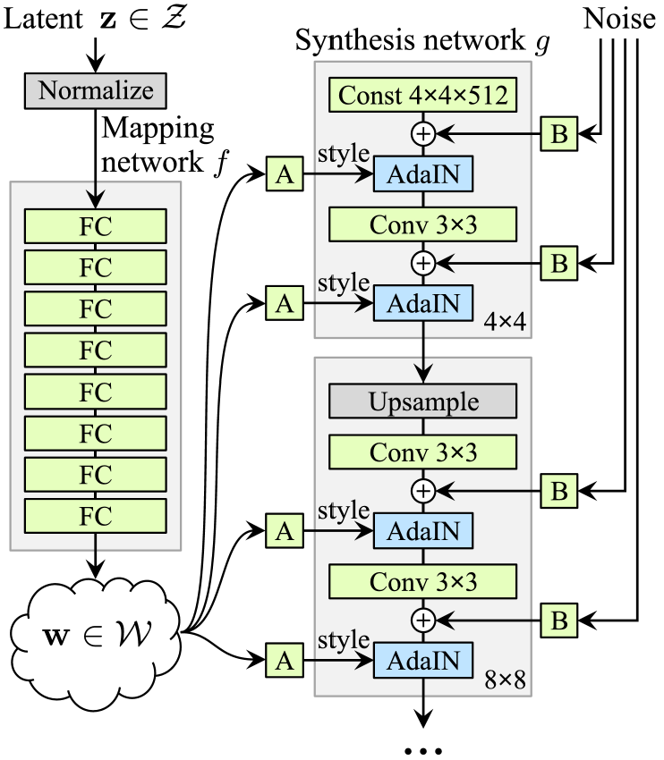
<br>
<em>
Figure 1. Mapping and synthesis networks of the original StyleGAN. From Karras et al. [2], Fig. 1(b). 
<strong>A</strong> denotes a learned affine transformation, while <strong>B</strong> applies 
learned scaling to the noise input. AdaIN belongs to the original StyleGAN design and is replaced 
by weight modulation and demodulation in the StyleGAN2 implementation.
</em>
</p>

As shown in Figure 1, the mapping network converts z into w, which controls synthesis through 
layer-specific styles. The synthesis network starts from a learned spatial constant rather than 
directly from z. Independent noise inputs provide stochastic variation at different resolutions. 
Although the constant is shared between samples, the styles and noise allow different images to be generated.

This separation provides a mechanism for modelling variation at different spatial scales, 
motivating its use for both broad brain structure and finer image appearance. However, it does not 
establish a correspondence between individual latent dimensions and anatomical or diagnostic 
attributes. StyleGAN2 retains this mapping-and-synthesis framework but changes how styles control 
the convolutions, as described below.

### 4.3 Weight Modulation and Demodulation

In the original architecture shown in Figure 1, adaptive instance normalisation (AdaIN) normalises 
feature maps before applying style-dependent scaling and offsets. Karras et al. [3] link this 
operation to characteristic droplet-like artefacts, as it can remove information carried by 
relative feature magnitudes. StyleGAN2 replaces explicit feature-map instance normalisation with 
weight modulation and demodulation.

<p align="center">

<br>
<em>
Figure 2. Redesign of the StyleGAN synthesis layer. From Karras et al. [3], Fig. 2. 
Panel (b) expands the original AdaIN operation, panel (c) reorganises the style block, 
and panel (d) replaces explicit feature normalisation with weight modulation and demodulation. 
Panel (a) provides the original synthesis-layer overview, whose mapping and noise pathways are shown more fully in Figure 1.
</em>
</p>

Figure 2(b) separates AdaIN into normalisation and modulation. Following the intermediate revision 
in Figure 2(c), the design in Figure 2(d) incorporates style-dependent scaling and its compensation 
into the convolution weights. This final mechanism is adopted in the present implementation.

Figure 2 uses $w_2$, $w_3$, and $w_4$ for convolution weights, distinct from the latent vector $w$. 
Here, $K$ denotes the learned base weights, $\widetilde{K}$ the style-modulated weights, 
and $\widehat{K}$ the final demodulated weights:

$$
\widetilde{K}_{o,i,u,v}=s_iK_{o,i,u,v}

\qquad

\widehat{K}_{o,i,u,v}
=
\frac{\widetilde{K}_{o,i,u,v}}
{\sqrt{\sum_{i,u,v}\widetilde{K}_{o,i,u,v}^{\,2}+\epsilon}}.
$$

Here, $s_i$ is the sample-specific style coefficient for input channel $i$, $o$ indexes output 
channels, and $(u,v)$ indexes kernel positions. Modulation adjusts each input channel's 
contribution, while demodulation compensates for the resulting output scale under the unit-variance 
input assumption. This operates on weights rather than measured feature-map statistics.

For MRI synthesis, reducing architecture-induced artefacts is relevant because artificial patterns 
can obscure or resemble structural detail. This provides a theoretical motivation for the mechanism, 
rather than a guarantee that generated anatomy is correct.

### 4.4 Multi-Scale Synthesis and Discriminator

The generator synthesises features from a learned 4 × 4 constant through successive resolution blocks. 
At each resolution, a style-modulated 1 × 1 convolution projects features into a single-channel 
image contribution. These contributions are combined through output skip connections:

$$
I_r=\operatorname{Upsample}(I_{r/2})
+\operatorname{ToImage}_r(x_r),
$$

where $x_r$ denotes the features at resolution $r$. The ToImage layers use modulation without 
demodulation. Filtered upsampling is used between resolutions. All resolution blocks are trained 
together from the start, rather than being added gradually during training.

Noise is added after the styled convolutions with a learned strength, followed by bias and activation. 
It provides a separate source of local stochastic variation, reducing the need to encode every 
detail in the latent vector. In this project, noise injection is a synthesis mechanism, not a 
calibrated model of physical MRI acquisition noise.

The discriminator follows the residual design adopted in StyleGAN2. Each downsampling block combines 
a convolutional main branch with a skip branch, with the sum scaled by $1/sqrt(2)$. A grouped 
minibatch-standard-deviation feature is added before the output layers to capture variation among 
samples. This allows the discriminator to use batch-level diversity cues, although it does not 
guarantee prevention of mode collapse. The discriminator outputs a single logit per image at the end 
of the network.

### 4.5 Training Objectives and Regularisation

StyleGAN2 is trained using non-saturating logistic objectives. With D denoting discriminator logits 
and $\operatorname{softplus}(t) = \log(1 + \exp(t))$, the adversarial losses are:

$$
L_D^{adv}
=
\mathbb{E}_{x}
\left[\operatorname{softplus}(-D(x))\right]
+
\mathbb{E}_{z}
\left[\operatorname{softplus}(D(G(z)))\right]
$$

$$
L_G^{adv}
=
\mathbb{E}_{z}
\left[\operatorname{softplus}(-D(G(z)))\right].
$$

Generator noise is implicit in this notation. R1 regularisation penalises the discriminator's input 
gradients at real images:

$$
R_1=
\frac{\gamma}{2}
\mathbb{E}_{x}
\left[\left\|\nabla_x D(x)\right\|_2^2\right].
$$

This constrains local discriminator sensitivity around real samples and supports stable optimisation. 
It does not impose a formal privacy guarantee.

Path length regularisation encourages a consistently scaled response to changes in the style vectors:

$$
\ell=
\sqrt{
\frac{1}{L}
\sum_{j=1}^{L}
\left\|
\nabla_{w_j}
\langle g(\mathbf{w}),y\rangle
\right\|_2^2
}

\qquad

R_{PL}=\lambda_{PL}\mathbb{E}\left[(\ell-a)^2\right].
$$

Here, $L$ is the number of style inputs, $y$ is resolution-normalised Gaussian noise, and $a$ is a moving average of the measured path lengths.

R1 and path length penalties use lazy regularisation, with interval scaling and corresponding 
optimiser adjustments. Style mixing discourages dependence between neighbouring styles, while 
generator EMA weights are used for sampling and final evaluation. The model is trained without ADA 
and evaluated against DCGAN as a complete system, without component-wise ablations.


## 5. Implementation

### 5.1 Project Structure

The project is implemented in Python using PyTorch. Network definitions, data loading, training, 
inference and evaluation are separated into modules:

```text
StyleGAN2_s4909628/
├── modules.py
├── dataset.py
├── train.py
├── predict.py
├── utils/
│   ├── dcgan.sh
│   ├── stylegan2.sh
│   ├── eval*.py
│   ├── export*.py
│   ├── audit_memorization.py
│   └── *.sh
├── splits/
├── runs/
├── evaluation/
└── README.md
```


| Component | Responsibility |
|---|---|
| `modules.py` | Defines the DCGAN and StyleGAN2 networks and reusable network components. |
| `dataset.py` | Associates slices with patients, manages fixed partitions, and provides image datasets and data loaders. |
| `train.py` | Contains training and validation routines, configuration handling, checkpointing and resource measurements. The current main entry point runs StyleGAN2. |
| `predict.py` | Reconstructs generators from checkpoint configurations and produces sample grids, selecting EMA weights for StyleGAN2 when available. |
| `utils/` | Contains evaluation utilities for cohort export, quality and diversity metrics, visualisation, memorisation auditing and latent-space analysis. |
| `splits/`, `runs/`, `evaluation/` | Store dataset manifests, training outputs and evaluation artefacts, respectively. |

### 5.2 Implementation and Experiment Management

StyleGAN2 is implemented using standard PyTorch operations, with grouped convolutions for per-sample 
weight modulation and automatic differentiation for R1 and path length regularisation. The official 
NVIDIA implementation was consulted as a reference [8].

Each run stores its configuration, training history and checkpoints. Checkpoints preserve model and 
EMA weights, optimiser and regularisation states, training progress and random-number states, 
enabling resumption at epoch boundaries. Dataset manifest hashes and evaluation metadata link the 
reported results to their data and model configurations.

## 6. Experimental Setup

Experiments were conducted on the Rangpur cluster using an NVIDIA A100 40 GB GPU. 
Both models used the dataset partitions and preprocessing described in Section 3 and were trained 
for 100 epochs with random seed 42. StyleGAN2 used FP32 tensors with TF32 and cuDNN benchmarking enabled; 
automatic mixed precision was disabled.

| Setting | DCGAN | StyleGAN2 |
|---|---|---|
| Training epochs | 100 | 100 |
| Batch size | 16 | 64 |
| Latent dimension | 128 | 512 |
| Mapping network | — | $W$ dimension 512; 8 layers  |
| Optimiser | Adam | Adam |
| Base learning rate (G / D) | 2e-4 / 2e-4 | 2e-3 / 2e-3 |
| Base Adam betas | (0.5, 0.999) | (0, 0.99) |
| R1 regularisation | — | Weight 10; every 16 batches |
| Path length regularisation | — | Weight 2; every 4 batches; half-batch |
| Style mixing probability | — | 0.9 |
| Generator EMA | — | 10 kimg target half-life; ramp-up 0.05 |
| Generated evaluation images | 5,000 | 5,000 |
| Real reference images | Same 5,000 test slices | Same 5,000 test slices |

StyleGAN2 optimiser values include lazy-regularisation adjustments. The shared real reference cohort 
was sampled without replacement, preserving the test set’s AD/NC proportions.

## 7. Image Quality and Fidelity

### 7.1 Generated Sample Comparison

The following grids show the first 16 images from each exported evaluation cohort in sample-ID order, 
without selection by visual quality.

<p align="center">
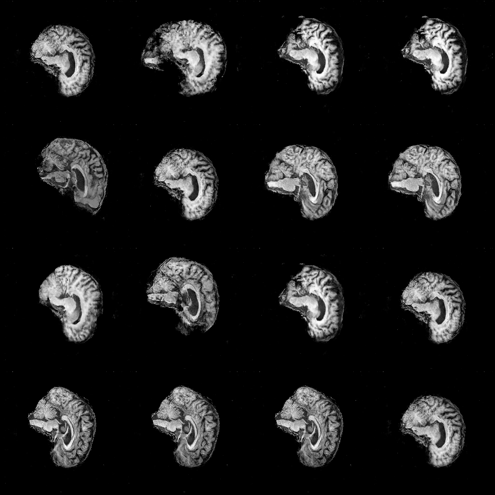
<br>
<em>
DCGAN samples from the final evaluation cohort.
</em>
</p>


<p align="center">
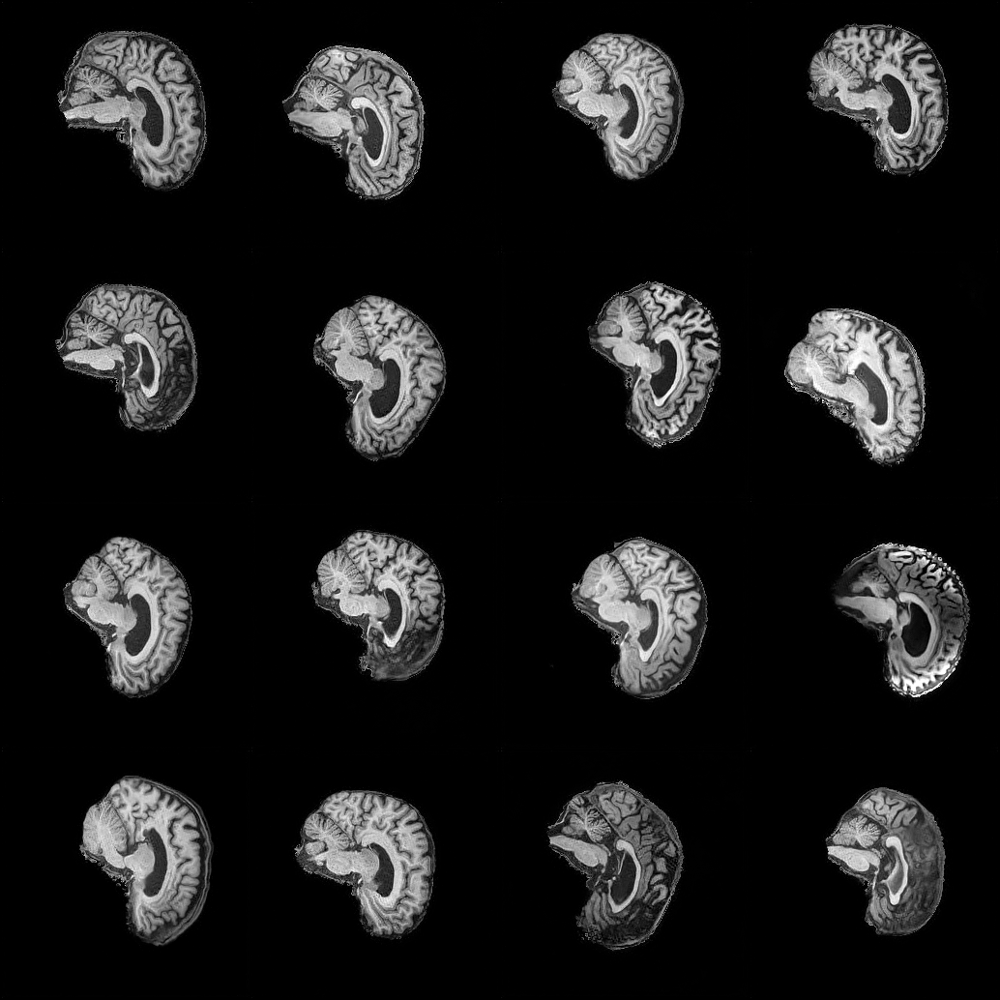
<br>
<em>
StyleGAN2 samples from the final evaluation cohort.
</em>
</p>

Both models produce recognisable brain-slice outlines. Visually, DCGAN samples frequently contain coarse, 
grainy textures and poorly resolved internal structures; StyleGAN2 generally produces more coherent 
contours and internal tissue patterns, although some samples retain uneven contrast, local blurring 
and background artefacts. These visual observations are examined quantitatively below.

### 7.2 Distributional Fidelity: FID

FID was calculated from 2,048-dimensional features extracted using the same frozen Inception network 
for all cohorts. Lower values indicate closer agreement between the feature distributions.

| Model | FID ↓ |
|---|---:|
| DCGAN | 93.536 |
| StyleGAN2 | **7.506** |

StyleGAN2 achieves a substantially lower FID, supporting better agreement with the real reference 
distribution under this feature representation. The real-versus-itself check returned approximately 
zero, providing a numerical consistency check. However, FID does not directly establish anatomical 
correctness or clinical usefulness.

### 7.3 Reference-Paired SSIM

Each generated image was paired with its nearest real reference image by Euclidean distance in the 
original Inception feature space. SSIM was then computed over the full images without registration. 
Each generated image was paired with its nearest real reference in feature space. Multiple generated 
images could share the same reference. These references were selected for similarity assessment and 
were not matched ground-truth images.

| Model | Mean SSIM ± SD | Median | SSIM > 0.6 |
|---|---:|---:|---:|
| DCGAN | 0.6731 ± 0.0407 | 0.6774 | 95.46% |
| StyleGAN2 | 0.6747 ± 0.0355 | 0.6765 | 97.74% |

<p align="center">
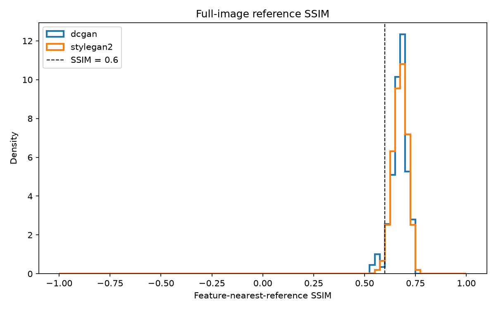
<br>
<em>
SSIM distributions for generated images paired with their nearest real references in Inception feature space.
</em>
</p>

The mean scores differ by only 0.0016, while StyleGAN2 has a slightly lower median. 
Reference-paired SSIM therefore provides little separation between the models despite their large 
FID difference. Shared background and similar outlines can contribute to high scores, 
whereas differences in slice geometry and positioning can reduce similarity. 
The proportion above 0.6 is descriptive and should not be interpreted as generation accuracy.

### 7.4 Sharpness: Laplacian and Tenengrad

Sharpness was assessed using Laplacian variance and Tenengrad gradient energy [9]. 
Both were measured over the full image and within an intensity-derived foreground region eroded by 
three pixels to reduce background and outer-boundary effects.

A preliminary blur-and-noise experiment confirmed that both measures respond to noise as well as 
image detail; higher scores therefore do not necessarily indicate better image quality.

| Cohort | Median Laplacian variance, interior | Median Tenengrad, interior |
|---|---:|---:|
| Real | 0.05122 | 0.00848 |
| DCGAN | 0.05648 | 0.00920 |
| StyleGAN2 | 0.04928 | 0.00881 |

<p align="center">
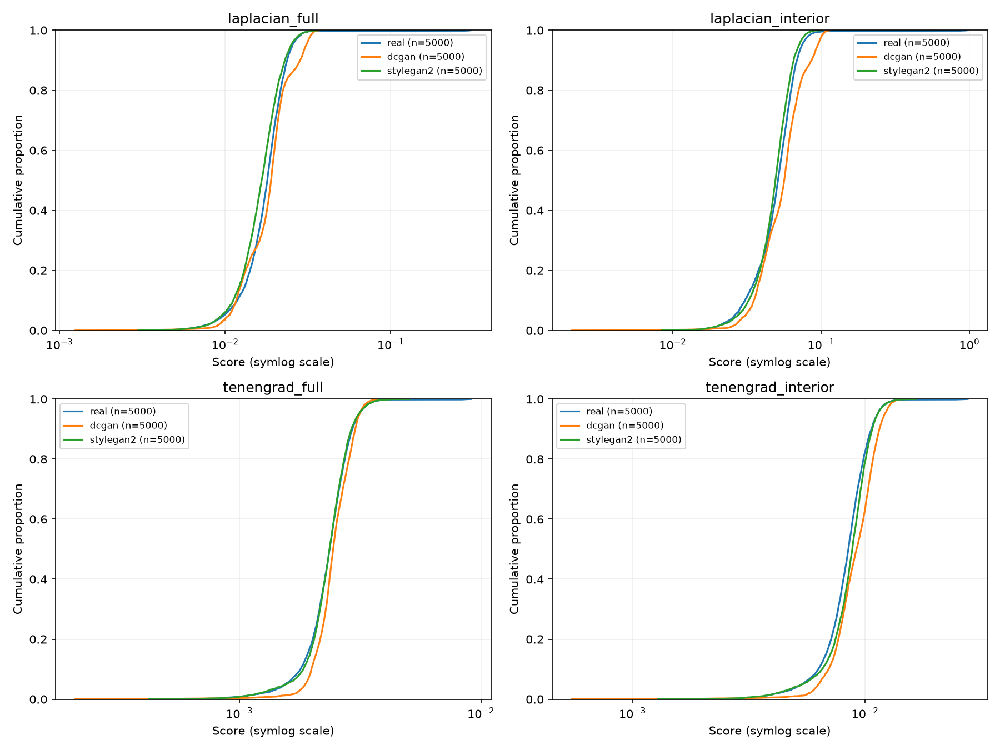
<br>
<em>
Empirical cumulative distributions of Laplacian variance and Tenengrad for full images and foreground interiors.
</em>
</p>

<details>
<summary>Sharpness calibration with blur and noise</summary>
<p align="center">
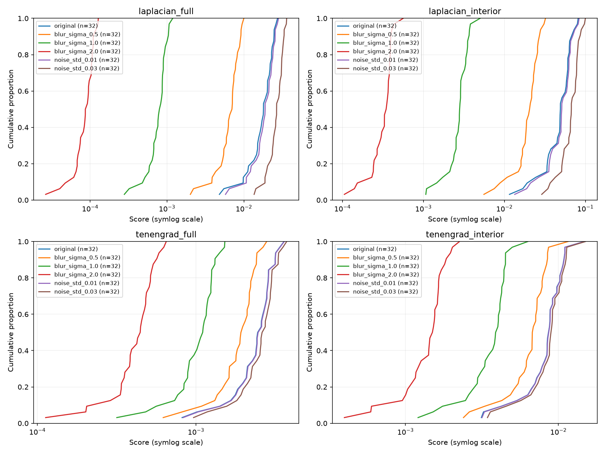
<br>
<em>
Controlled perturbations demonstrate sensitivity to both blur and noise.
</em>
</p>
</details>

StyleGAN2's interior medians are closer to the real reference values for both measures. 
DCGAN has higher medians, consistent with its visible high-frequency texture, although these 
measurements cannot distinguish useful detail from noise. StyleGAN2's slightly lower interior Laplacian
median may also reflect softer fine-scale detail. The distributions therefore complement the visual 
comparison and FID rather than provide a standalone ranking of image quality.

## 8. Distribution Coverage and Diversity

### 8.1 Joint t-SNE Embedding

The three cohorts were jointly embedded using PCA to 50 dimensions, followed by t-SNE with 
perplexity 30 and seed 2026.

<p align="center">
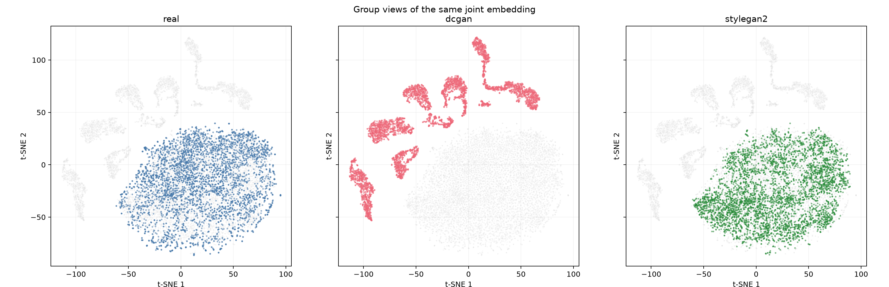
<br>
<em>
Group-specific views of the same joint t-SNE embedding; grey points show the remaining cohorts.
</em>
</p>

StyleGAN2 samples occupy much of the region populated by real images, whereas DCGAN forms several 
largely separate clusters. This suggests that DCGAN generates a restricted collection of patterns 
whose features differ from the real distribution. StyleGAN2 shows substantially better overlap, 
consistent with its lower FID.

The same broad separation persists at perplexity 50, suggesting that the observation is not specific 
to the selected perplexity. However, overlap in this projection does not establish complete coverage:
t-SNE does not preserve global distances or distribution densities, and both this analysis and FID 
use the same Inception representation.

### 8.2 Within-Cohort Pairwise SSIM

SSIM was calculated for 5,000 randomly sampled distinct-image pairs per group, with an additional 
real-image reference restricted to different patients. Unlike Section 7.3, no nearest-neighbour matching was used.

| Cohort / pairing | Mean SSIM | Median | 95th percentile |
|---|---:|---:|---:|
| Real (unrestricted) | 0.6634 | 0.6656 | 0.7117 |
| Real (cross-patient) | 0.6631 | 0.6660 | 0.7137 |
| DCGAN | 0.7076 | 0.6698 | 0.9894 |
| StyleGAN2 | 0.6642 | 0.6663 | 0.7177 |

<p align="center">
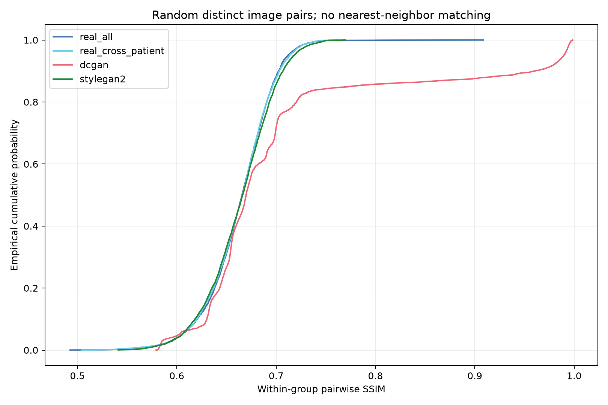
<br>
<em>
Within-cohort pairwise SSIM distributions, including a real cross-patient reference.
</em>
</p>

DCGAN's median is close to the real reference, but its 95th percentile reaches 0.9894. 
This pronounced high-similarity tail indicates that some independently generated images are nearly 
identical, a failure that the median alone would conceal. Inspection of the highest-scoring pairs 
confirms repeated outlines and internal textures, supporting partial mode collapse rather than 
uniformly low diversity across all outputs.

StyleGAN2 closely follows the real cross-patient distribution in both its centre and upper tail. 
Its 95th percentile is 0.7177, compared with 0.7137 for real cross-patient pairs, with no comparable 
near-identical tail among the sampled pairs. The unrestricted and cross-patient real curves also 
nearly coincide, indicating that the reference pattern is not primarily driven by within-patient pairs.

Together, these results support better preservation of image variation by StyleGAN2. 
They do not establish complete anatomical or diagnostic diversity, because full-image SSIM remains 
sensitive to shared background and slice geometry.

<details>
<summary>Examples of near-identical DCGAN outputs</summary>

<p align="center">
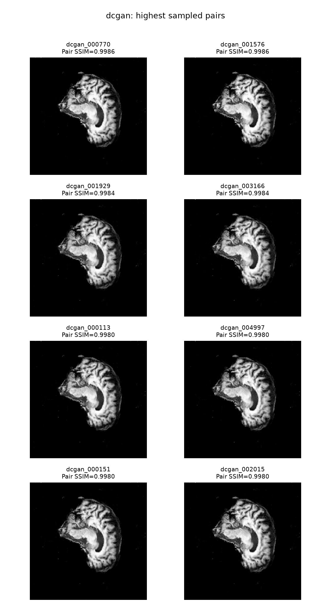
<br>
<em>
The four highest-SSIM pairs among the sampled DCGAN pairs. Distinct generated samples reproduce 
nearly identical outlines and internal textures.
</em>
</p>

</details>

## 9. Memorisation and Privacy Audit

### 9.1 Training-Set Nearest Neighbours

Each generated image was compared against all 17,480 training slices using Euclidean distance in 
Inception feature space. Real validation images from patients absent from training provided the primary control.

<p align="center">
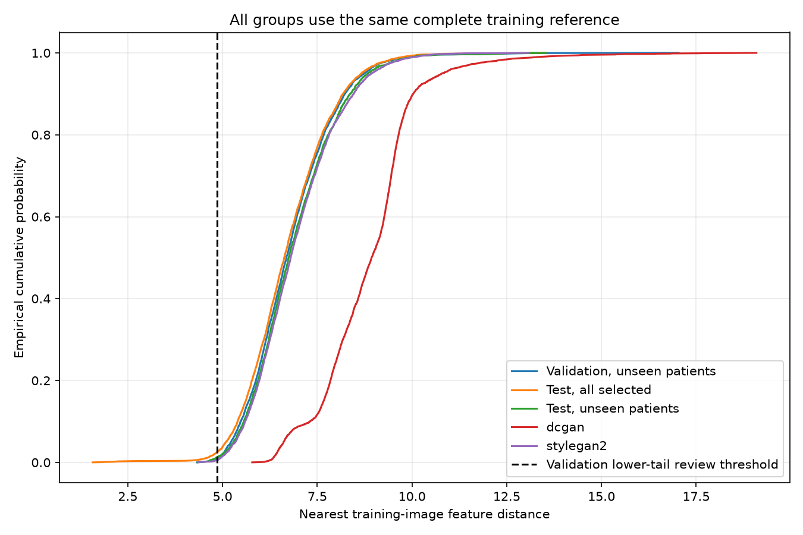
<br>
<em>
Nearest-training-image distance distributions. The dashed line marks the first percentile of the validation control distances.
</em>
</p>

| Query cohort | Median nearest-training distance |
|---|---:|
| Real validation, unseen patients | 6.687 |
| Real test, unseen patients | 6.744 |
| DCGAN | 8.932 |
| StyleGAN2 | 6.800 |

StyleGAN2's distance distribution closely follows the unseen-patient controls, rather than showing 
a broad shift towards unusually close training matches. This is consistent with learning shared 
image characteristics without widespread near-copying detectable by this representation. 
DCGAN's larger distances instead align with its poorer distributional fidelity; distance alone 
cannot rank privacy protection.

The unseen-patient controls are important because the original test partition contains patients 
also present in training. Using all test images alone could make unusually close training matches 
appear less exceptional.

### 9.2 Exact Matches and Flagged Samples

Generated images were flagged when their nearest-training distance was below 4.8589, the first 
percentile of validation control distances. The five nearest feature candidates were additionally 
compared using SSIM and pixel error, without image registration.

| Audit result | DCGAN | StyleGAN2 |
|---|---:|---:|
| Generated images audited | 5,000 | 5,000 |
| Exact training-image pixel matches | 0 | 0 |
| Flagged candidates | 0 (0.00%) | 30 (0.60%) |
| Distinct nearest training images | 267 | 3,242 |
| Distinct nearest training patients | 106 | 420 |
| Maximum queries sharing one nearest training image | 576 | 11 |

Neither cohort contains an exact training-image match in the evaluated uint8 representation. 
StyleGAN2's 30 flagged images occupy the unusually close tail of the feature-distance distribution, 
but the flag is a screening rule rather than a memorisation decision. Its 0.60% flag rate does not 
estimate the probability of privacy leakage.

DCGAN's nearest-neighbour assignments are highly concentrated: 576 outputs share a single nearest 
training image, compared with 11 for StyleGAN2. Together with the repeated outputs observed in Section 8, 
this supports restricted generation rather than evidence that the matched training image was copied. 
StyleGAN2's assignments are more widely distributed, although this does not establish complete patient
or anatomical coverage.

### 9.3 Interpretation and Audit Limitations

The automated audit found no exact training-image copies and no broad excess of unusually small 
feature distances for StyleGAN2. The 30 flagged candidates remain unresolved pending further examination.

These findings apply only to the sampled outputs and the chosen representation. Inception features 
may miss medically meaningful or transformed copies, and candidate SSIM searches cover only the five 
feature neighbours rather than every training image. The audit therefore provides limited empirical 
evidence about memorisation, not a formal privacy guarantee or a membership-inference evaluation.

## 10. Latent Space Investigation

### 10.1 Random Latent Interpolation

Nine frames were generated along each path, using spherical interpolation in Z and linear 
interpolation in StyleGAN2's shared W space. StyleGAN2 synthesis noise was held constant.

<p align="center">
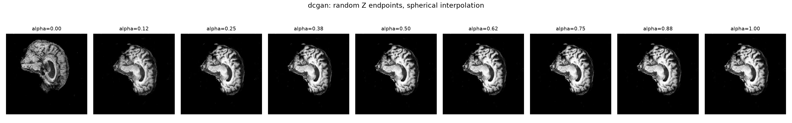
<br>
<em>DCGAN: the first sampled Z interpolation.</em>
</p>

<p align="center">
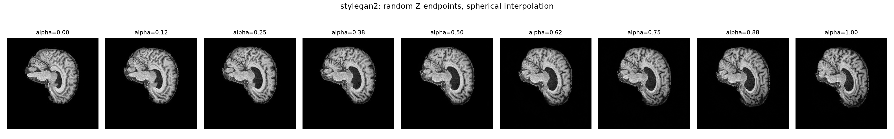
<br>
<em>StyleGAN2: the first sampled Z interpolation.</em>
</p>

<p align="center">
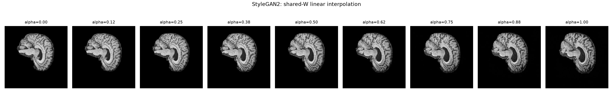
<br>
<em>StyleGAN2: W interpolation between the mapped versions of the same endpoints.</em>
</p>

DCGAN changes markedly between the first two displayed frames, followed by a long interval of nearly 
unchanged outputs. This suggests that substantial latent variation maps to similar images, 
consistent with the repetitive outputs identified in Section 8.

StyleGAN2 shows more gradual changes in outline, internal structure and contrast across both paths. 
Its Z and W paths share endpoints but follow different intermediate appearances. These examples 
demonstrate useful latent variation, but do not establish that W interpolation is systematically 
smoother or that individual anatomical attributes are disentangled.

### 10.2 Real-Image Projection

Four real slices were projected: one AD and one NC image from each of the training and validation sets. 
Generator weights were frozen while optimising DCGAN's Z or StyleGAN2's shared W, using two restarts of
800 steps. StyleGAN2 noise was fixed and not optimised.

| Target | DCGAN SSIM | StyleGAN2 SSIM | DCGAN foreground MAE | StyleGAN2 foreground MAE |
|---|---:|---:|---:|---:|
| Train AD | 0.6526 | 0.7902 | 0.2354 | 0.1015 |
| Train NC | 0.7099 | 0.8263 | 0.2501 | 0.0815 |
| Validation AD | 0.7132 | 0.8425 | 0.2051 | 0.0867 |
| Validation NC | 0.6980 | 0.8242 | 0.2106 | 0.0762 |

Foreground MAE uses the union of target and reconstruction pixels with intensity above 0.05. 
Metrics are calculated from exported images after clipping and uint8 conversion.

<p align="center">
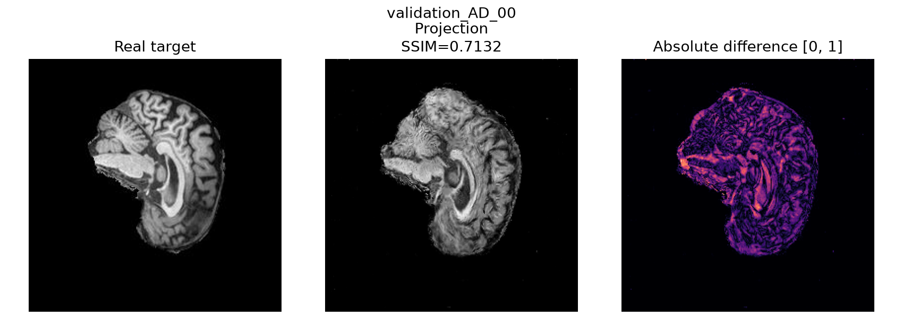
<br>
<em>DCGAN projection of the selected validation AD slice.</em>
</p>

<p align="center">
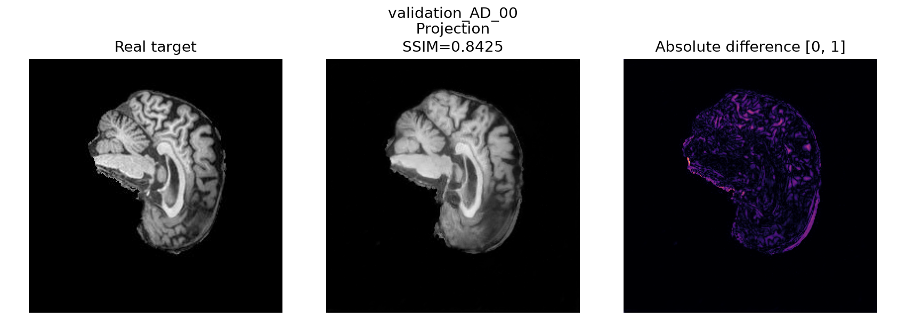
<br>
<em>StyleGAN2 projection of the same target.</em>
</p>

StyleGAN2 achieves higher SSIM and lower foreground error on all four targets. In the displayed example, 
it better reproduces the overall shape and major internal structures, while fine folds remain 
blurred or displaced. DCGAN retains stronger texture and structural mismatches. 
Thus, the improvement extends beyond agreement over the black background.

The optimisation records qualify this comparison. Three DCGAN targets reach their best objective 
within the first 15 steps, whereas all StyleGAN2 targets reach their best values at steps 799–800. 
This suggests that DCGAN's results are affected by the optimisation trajectory, while StyleGAN2 may 
still benefit from a larger optimisation budget. The comparison therefore measures reconstruction 
under the chosen procedure, not each model's best achievable reconstruction.

The latent spaces also differ in dimension and constraints. Four targets are insufficient to infer 
a population-level reconstruction advantage or a training-versus-validation generalisation gap.

### 10.3 Interpolation Involving Projected Images

<p align="center">
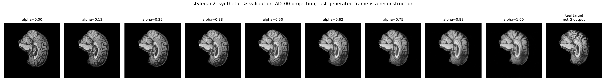
<br>
<em>
StyleGAN2 interpolation from a random generated image to the validation AD projection. The final reference image is the real target.
</em>
</p>

<p align="center">
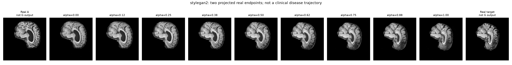
<br>
<em>
StyleGAN2 interpolation between two projected AD targets. The outermost images are real references; 
generated endpoints are their approximate reconstructions.
</em>
</p>

Both paths show gradual changes in shape and internal appearance without the prolonged repetition seen in the displayed DCGAN random interpolation. However, reconstruction errors persist at the endpoints, and intermediate images can be softer than the real references. A visually continuous path therefore demonstrates navigability within the learned generator, not faithful recovery of every structure between the targets.

These interpolations are synthetic transitions between latent codes. They do not represent adjacent 
MRI slices, longitudinal disease progression or controlled changes in diagnosis.

## 11. Training Behaviour and Computational Cost

### 11.1 Training Behaviour

DCGAN developed a strong training imbalance: by epoch 100, discriminator loss fell to 0.041 while 
generator loss reached 11.108. StyleGAN2's adversarial losses stabilised after approximately 15 epochs, 
with training and validation curves remaining relatively close. This suggests more stable adversarial behaviour, 
although loss values alone do not establish generation quality.

### 11.2 Training Time and GPU Memory

| Measurement | DCGAN | StyleGAN2 |
|---|---:|---:|
| Generator parameters | 8.03 million | 24.76 million |
| Training batch size | 16 | 64 |
| Recorded duration over 100 epochs | 39.20 min* | 22.47 h |
| Peak allocated training memory | 1.28 GiB† | 37.33 GiB |
| Peak reserved training memory | 1.30 GiB† | 38.98 GiB |

*Training times use different scopes: DCGAN sums epoch logs. StyleGAN2 excludes validation, sampling and checkpoint I/O.

†DCGAN memory comes from a separate three-epoch run, including the initial peak. 
Memory figures refer to the PyTorch allocator.

StyleGAN2 has 3.1× more generator parameters and substantially higher resource costs, although 
differing batch sizes and measurement procedures limit direct comparison.

### 11.3 Generation Throughput and Latency

Both models were benchmarked on the A100 using 10 warm-up iterations and 50 measured iterations, with CUDA synchronisation.

| Measurement | DCGAN | StyleGAN2 |
|---|---:|---:|
| Forward throughput, batch size 32 | 12,916 images/s | 385 images/s |
| Mean single-image latency, batch size 1 | 0.77 ms | 8.99 ms |
| End-to-end PNG export throughput | 281.8 images/s | 139.4 images/s |

Forward timings exclude transfers and file writing, with latent inputs already on the GPU. 
Export timings additionally include transfer, image conversion and PNG/manifest writing.

DCGAN achieves approximately 33.5 times the batch-forward throughput and 11.7 times lower 
single-image latency. The export throughput gap narrows to approximately twofold because 
non-forward processing forms a substantial part of the workflow. StyleGAN2 therefore trades 
considerably higher computational cost for the improved fidelity and diversity demonstrated in Sections 7–8.

## 12. Failure Case Analysis

<p align="center">
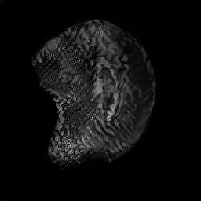
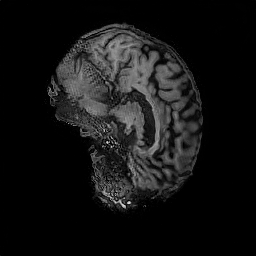
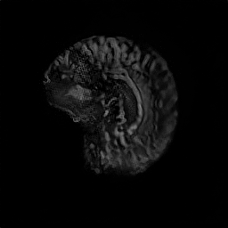
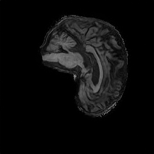
<br>
<em>
Selected StyleGAN2 failures, left to right: 00131, 00400, 03184 and 00158.
</em>
</p>

| Sample | Observed failure mode | Possible contributing mechanism |
|---|---|---|
| 00131 | Dense, repetitive high-frequency patterns obscure internal detail. | Learned texture repetition or synthesis/upsampling artefacts may produce strong edges without meaningful structure. |
| 00400 | Grainy regions transition into smoother folds, producing inconsistent local texture and poorly resolved boundaries. | Local detail synthesis may not remain coherent with the larger-scale structure. |
| 03184 | Low contrast and dark internal regions reduce visibility of tissue boundaries. | Unconditional sampling may reproduce or exaggerate intensity variation in the training distribution. |
| 00158 | Parts of the outer edge are surrounded by thin, bright borders and some scattered dots. | These examples show that plausible overall shape can coexist with local texture, contrast and boundary failures. 
They also explain why sharpness alone is insufficient since artificial edges can increase its score. 

## 13. Engineering Discussion and Limitations

StyleGAN2 provides a stronger quality–diversity trade-off than DCGAN in this experiment. 
Its lower FID, real-like pairwise similarity distribution and better projections support the 
additional model complexity. However, the substantially greater training and inference cost makes 
it more suitable for offline cohort generation than resource-constrained deployment.

The comparison evaluates complete implementations, not architecture alone, including batch sizes, 
regularisation and sampling weights differ, and equal epoch counts do not imply equal computational budgets. 
These results show that StyleGAN2 outperformed DCGAN in this experiment. Further runs with different 
random seeds and component ablations are needed to assess consistency and identify the contribution of each mechanism.

Evaluation also has important boundaries. SSIM and sharpness depend on geometry, background and texture. 
The training and test sets share data from the same patients, which may limit claims about the 
unseen-patient generalisation of models. The memorisation audit therefore uses patient-disjoint 
validation controls.

Finally, the model generates unconditional 2D slices rather than diagnosis-controlled images. 
Future work could introduce AD/NC conditioning, add slice-position conditioning to control the 
anatomical level, and investigate artefact reduction to improve local texture and boundary consistency.

## 14. Conclusion

The custom StyleGAN2 implementation without ADA outperformed the DCGAN baseline on distributional 
fidelity and output diversity, reducing FID from 93.536 to 7.506. This improvement required 
substantially greater computational resources and did not eliminate local image artefacts.

The project demonstrates the feasibility of generating varied ADNI-like 2D MRI slices for further 
research. Clinical usefulness and privacy-safe release remain unestablished.

## 15. Usage

Run commands from the `StyleGAN2_s4909628` directory containing
`train.py`, not from `utils/`. The cluster scripts expect a configured
Conda environment named `torch` and access to the course ADNI data.
Data paths and model settings are defined in `build_config()`.

### 15.1 Training

Create the log directory before submitting a job:

```bash
mkdir -p logs
sbatch utils/stylegan2.sh 20 --batch-size 64
```

This starts a new StyleGAN2 run with a total target of 20 epochs. The script requests one GPU, 
four CPUs and a ten-hour time limit.

### 15.2 Resuming Training

To continue a completed 20-epoch run to 40 epochs:

```bash
sbatch utils/stylegan2.sh 40 \
  --batch-size 64 \
  --resume runs/<run_name>/checkpoints/latest.pt
```

Replace `<run_name>` with the existing run directory. The epoch argument specifies the total target, 
not the number of additional epochs. Batch size and worker count must match the saved configuration.

Each run stores checkpoints, generated previews, configuration and training history 
under `runs/<run_name>/`. Slurm logs are written to `logs/`.

### 15.3 Generating Images

Within an allocated GPU session, generate a reproducible sample grid:

```bash
conda run --no-capture-output -n torch \
  python predict.py \
  --checkpoint runs/<run_name>/checkpoints/final.pt \
  --output outputs/generated_grid.png \
  --num-images 16 \
  --nrow 4 \
  --seed 42
```

The checkpoint determines the generator architecture; StyleGAN2 uses EMA weights when enabled.

The current training entry point runs StyleGAN2. The retained `utils/dcgan.sh` is a historical job 
script and requires the DCGAN training entry point before it can reproduce the baseline.

## 16. Artificial Intelligence Usage Disclosure
ChatGPT was used during the development of this project.
Used to assist in learning, building network architectures and evaluation metrics, and debugging code.


## 17. References
[1] J. Hayes et al., "LOGAN: Membership Inference Attacks Against Generative Models," *PoPETs*, 2019.
[Paper](https://arxiv.org/abs/1705.07663)

[2] T. Karras, S. Laine, and T. Aila, "A Style-Based Generator Architecture for Generative Adversarial Networks," in *Proc. CVPR*, 2019. [Paper](https://arxiv.org/abs/1812.04948)

[3] T. Karras et al., "Analyzing and Improving the Image Quality of StyleGAN," in *Proc. CVPR*, 2020. [Paper](https://arxiv.org/abs/1912.04958)

[4] A. Radford, L. Metz, and S. Chintala, "Unsupervised Representation Learning with Deep Convolutional Generative Adversarial Networks," in *Proc. ICLR*, 2016. [Paper](https://arxiv.org/abs/1511.06434)

[5] Z. Wang, A. C. Bovik, H. R. Sheikh, and E. P. Simoncelli, "Image Quality Assessment: From Error Visibility to Structural Similarity," *IEEE Transactions on Image Processing*, vol. 13, no. 4, pp. 600–612, 2004. [Paper](https://doi.org/10.1109/TIP.2003.819861)

[6] M. Heusel et al., "GANs Trained by a Two Time-Scale Update Rule Converge to a Local Nash Equilibrium," in *Proc. NeurIPS*, 2017. [Paper](https://arxiv.org/abs/1706.08500)

[7] T. Karras et al., "Training Generative Adversarial Networks with Limited Data," in *Proc. NeurIPS*, 2020. [Paper](https://arxiv.org/abs/2006.06676)

[8] NVIDIA Research (NVlabs), "StyleGAN2-ADA — Official PyTorch Implementation," GitHub Repository. [Online]. Available: https://github.com/NVlabs/stylegan2-ada-pytorch

[9] S. Pertuz, D. Puig, and M. A. Garcia, "Analysis of Focus Measure Operators for Shape-from-Focus," *Pattern Recognition*, vol. 46, no. 5, pp. 1415–1432, 2013. [Paper](https://doi.org/10.1016/j.patcog.2012.11.011)

